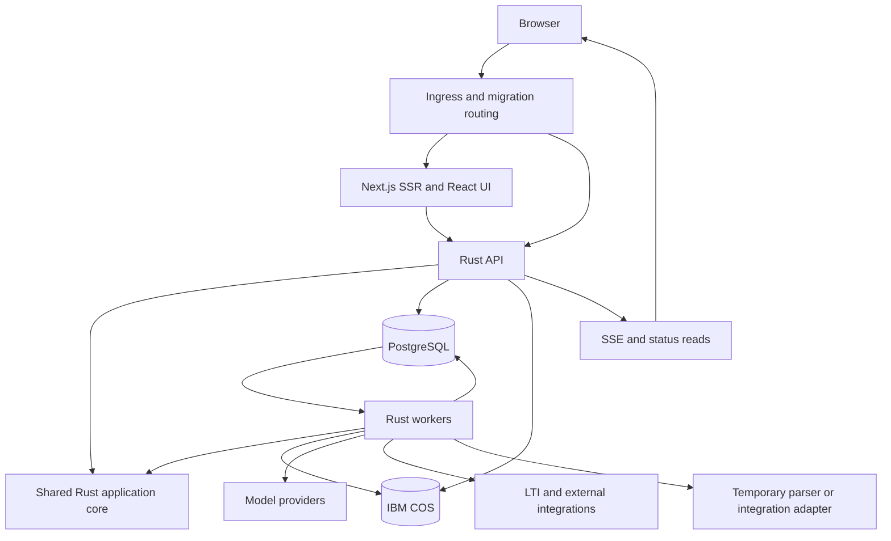
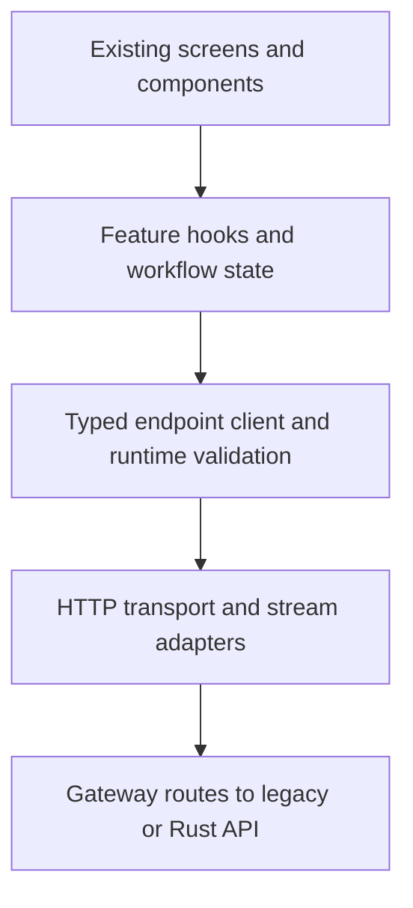

**Master implementation plan for the Mark platform**\
Prepared for the Mark platform team • 22 October 2026

Rebuild Mark’s backend around the assessment lifecycle: author and publish an assessment, accept a learner’s submission, produce an explainable grade, and deliver the result to the learning platform. Preserve the frontend’s visual identity while making its API boundary, asynchronous state, and error handling reliable. Retain Next.js server rendering initially; evaluate static client rendering after the API and launch flows are stable.

The recommended destination is a **modular Rust backend with independently deployed API and worker processes**, PostgreSQL as the system of record, and the existing object storage and institutional integrations. Implement it in the existing repository through short-lived branches, a shared API contract, and a tested mixed-runtime deployment path. Move complete workflows incrementally with recorded execution ownership.

This is a capability-led migration. Completion means that agreed user journeys work reliably, existing learning records remain correct, and operations can support the replacement. The percentage of TypeScript files translated is not a useful measure of progress.

# 1 Executive recommendation

Adopt the following implementation decisions:

1. **Preserve React and the existing design; keep Next.js initially.** Rust integrates with server-rendered and client-rendered frontends equally well. Keep SSR during the early migration, then remove the frontend server if a measured static-hosting trial proves that its responsibilities can be handled cleanly elsewhere.

2. **Build one coherent Rust application core, deployed as an API and workers.** Introduce workers as complete workflows need them. Keep most business boundaries inside the codebase and split deployment where scaling or resource isolation requires it.

3. **Keep PostgreSQL and IBM Cloud Object Storage initially.** Changing the language, database engine, data model, queue, frontend framework, and cloud provider together would unnecessarily enlarge the migration.

4. **Make assessment versions, submissions, grading runs, and grade delivery explicit.** These concepts should control transaction boundaries and workflow state.

5. **Deliver one complete workflow, then expand through controlled coexistence.** Keep one authoritative writer for each capability and cohort, with attempt/job ownership recorded durably. Do not wait for a complete rewrite or rely on a global environment-variable flip.

6. **Make frontend reliability and contract enforcement part of the migration.** Validate server responses at runtime, classify failures honestly, preserve user work, and use typed feature-level API access. Preserve the visual design.

7. **Use the existing repository and incremental integration.** Merge short-lived branches into the normal integration branch, use Cargo for Rust and Yarn/Turborepo for JavaScript, and continuously test supported legacy/mixed deployments.

8. **Treat quality and release controls as product requirements.** Grading/evidence quality, API compatibility, data integrity, worker recovery, and LMS delivery must pass explicit gates. Build immutable release artifacts and coordinate one database migration stream.

The strongest expected benefits are clearer ownership, bounded resource use, more reliable recovery, and easier verification of business rules. Rust can support these outcomes, but it does not automatically improve prompts, database queries, grading accuracy, or provider response time. Measure each separately.

The principal planning allowance remains **24–32 weeks**, with staffing, scope assumptions, and uncertainty in Section 21. Frontend boundary improvements and CI/tooling are included workstreams. Static-hosting conversion is a separate decision gate, and retiring every temporary parser/integration bridge may require additional effort.

The plan is organized into assessment and architecture (Sections 2–7), frontend and contracts (8–10), domain/data/workflows (11–15), engineering delivery (16–20), and execution controls (21–25). Section 24 provides the initial implementation backlog.

# 2 Assessment basis and decision limits

The source assessment covers public `master` files available on 22 October 2026: application manifests, API and gateway wiring, selected controllers and services, worker and queue code, the Prisma schema and a relevant SQL migration, frontend rendering/theme and API/error-handling files, and testing documentation. The public sources establish implemented structures and exposed capabilities; they do not establish which features are enabled or used in production.

An immutable source revision, deployed configuration, production traffic, database contents, cloud topology, and live browser behavior still need to be captured during discovery. Source links below follow `master` and may change. The assessment was static; no application build, runtime test, or production benchmark was performed. No repository files, branches, or pull requests were changed.

Three distinctions govern the plan:

- **Observed:** directly supported by the linked source.

- **Proposed:** the recommended destination or migration method.

- **To validate:** a product, deployment, or usage decision that source inspection cannot settle.

The repository describes Mark as an educational assessment platform with AI grading, feedback, multiple submission formats, multilingual support, and progress tracking. Its implementation also exposes substantial administration, support, chat, and LMS integration responsibilities. These belong in the migration scope inventory, even when they move after the principal assessment workflow. [Platform overview](https://github.com/ibm-skills-network/mark/blob/master/README.md), [API module composition](https://github.com/ibm-skills-network/mark/blob/master/apps/api/src/api/api.module.ts).

# 3 Capability inventory and migration priorities

“Core” means necessary to deliver and operate assessments. “Supporting” means an independently sequenced product capability, not an automatic candidate for removal. Preserve an existing capability through either Rust or an explicit legacy adapter until the product owner approves its retirement.

| Capability | Observed platform responsibilities | Migration treatment |
| - | - | - |
| Identity and access | Learner, author, and admin sessions; cookie and bearer authentication paths; assignment and LMS context | Core foundation. Central policy and authenticated context in Rust; preserve launch and cookie compatibility |
| Assessment authoring | Assignment settings, questions, scoring configuration, generated questions, variants, and attached author material | Core. One authoring domain with typed commands |
| Drafts and publication | User drafts, assignment versions, comparison, restoration, and publishing workflows | Core. Separate mutable drafts from immutable published assessment content |
| Learner attempts | Attempt eligibility, resume behavior, submission, response validation, time and attempt restrictions | Core. Transactional lifecycle with idempotent commands |
| Grading and feedback | Choice and true/false strategies; text, URL, file, image, and presentation grading; grading progress and regrading | Core. Deterministic scoring separated from evidence-based AI evaluation |
| Content and evidence | Uploads, object storage, document extraction, structured evidence, and highlighting-related data | Core for supported file formats. Preserve evidence fidelity before replacing parsers |
| Localization | Assignment, question, variant, and feedback translation; translation maintenance | Core for currently supported locales. Version translations against source content |
| LMS result delivery | Grade synchronization through an external LTI gateway, retries, and administrative recovery | Core integration. Grade completion and delivery completion are separate states |
| Operational control | Queue status, translation repair, regrading requests, flagged submissions, model/pricing controls, AI switches | Core operations. Ship essential recovery tools before increasing traffic |
| Analytics | Assignment and attempt insights, grade aggregates, AI cost reporting | Preserve. Read models can migrate separately from writes |
| AI assistant | Scoped chat, history, streaming, tool interactions, and attachments | Supporting. Preserve behind an adapter initially; migrate after authorization and command contracts stabilize |
| Support and notifications | User reports, GitHub-related workflows, Flo/Skills Network support routing, email-related controls | Supporting. Separate support-case handling from assessment analytics |

Evidence for these boundaries: [Session model](https://github.com/ibm-skills-network/mark/blob/master/apps/api/src/auth/interfaces/user.session.interface.ts), [assignment module](https://github.com/ibm-skills-network/mark/blob/master/apps/api/src/api/assignment/v2/modules/assignment.module.ts), [draft endpoints](https://github.com/ibm-skills-network/mark/blob/master/apps/api/src/api/assignment/v2/controllers/draft-management.controller.ts), [version endpoints](https://github.com/ibm-skills-network/mark/blob/master/apps/api/src/api/assignment/v2/controllers/version-management.controller.ts), [attempt module](https://github.com/ibm-skills-network/mark/blob/master/apps/api/src/api/attempt/attempt.module.ts), [admin module](https://github.com/ibm-skills-network/mark/blob/master/apps/api/src/api/admin/admin.module.ts), [analytics response and assignment endpoints](https://github.com/ibm-skills-network/mark/blob/master/apps/api/src/api/assignment/v2/controllers/assignment.controller.ts).

The format acceptance matrix must distinguish question type from submission format. The schema declares text, choice, true/false, URL, upload, and combined link/file questions, with response categories including code, repository, essay, presentation, video, audio, images, spreadsheet, and live recording. A declared category is not proof that every file type or grading path is production-ready. Likewise, the schema’s manual-assignment enum is not sufficient evidence of a complete manual-marking workflow. Discovery must demonstrate the journeys actually offered to users. [Schema](https://github.com/ibm-skills-network/mark/blob/master/apps/api/prisma/schema.prisma).

# 4 Existing applications and services

| Current component | Role established by source | Proposed disposition |
| - | - | - |
| `apps/web` | Next.js/React frontend with rich text, styling, interactive controls, and browser media dependencies | Retain and refactor selectively |
| `apps/api-gateway` | Authentication, forwarding to Mark and the LTI credential manager, special streaming handling, administrative role support | Retain during migration; eventually absorb Mark-specific policy into Rust and keep standard routing at the ingress |
| `apps/api` | NestJS application containing the principal business capabilities and persistence access | Replace by capability with a Rust application core |
| `apps/jobs` | BullMQ workers, consuming multiple job classes and invoking application functionality | Replace with Rust workers; preserve legacy queue handling until drained |
| PostgreSQL and Prisma | Durable application data and the existing schema/migration history | Keep PostgreSQL; replace Prisma access with reviewed SQL through Rust |
| Redis and BullMQ | Background queues and transient job state | Keep for legacy execution; introduce a language-neutral durable job contract for migrated work |
| NATS and Skills Network messaging | Platform integration and event publication | Preserve required external subjects and message envelopes |
| IBM Cloud Object Storage | S3-compatible storage and multipart operations | Retain buckets and keys initially; replace the client adapter |
| External LTI services | Credential-management forwarding and grade callbacks | Preserve as external integrations; their implementation is outside this repository’s rewrite |
| Model providers, GitHub, support services, email, Instana | AI, collaboration/support, notifications, and telemetry | Use explicit adapters with contract tests and operational ownership |

The manifests identify the four applications and the API/jobs dependency on BullMQ; local Compose defines PostgreSQL and Redis. These are separate from NATS messaging. Do not assume that the existence of NATS makes it the current durable job queue. [Root workspace](https://github.com/ibm-skills-network/mark/blob/master/package.json), [web manifest](https://github.com/ibm-skills-network/mark/blob/master/apps/web/package.json), [API manifest](https://github.com/ibm-skills-network/mark/blob/master/apps/api/package.json), [jobs manifest](https://github.com/ibm-skills-network/mark/blob/master/apps/jobs/package.json), [local infrastructure](https://github.com/ibm-skills-network/mark/blob/master/docker-compose.yml).

The gateway handles distinct authentication and streaming paths and forwards credential-management requests to another service. Removing it requires replacing those behaviors, not simply changing the frontend’s API URL. Object storage explicitly uses IBM COS configuration through an S3 client. [Gateway routes](https://github.com/ibm-skills-network/mark/blob/master/apps/api-gateway/src/api/api.controller.ts), [forwarding implementation](https://github.com/ibm-skills-network/mark/blob/master/apps/api-gateway/src/api/api.service.ts), [COS adapter](https://github.com/ibm-skills-network/mark/blob/master/apps/api/src/api/files/services/s3.service.ts).

# 5 Redesign priorities supported by the code

## Separate execution from HTTP wiring

The jobs application imports modules directly from the API source tree and registers a translation controller as a job runner. The worker also supports local execution or forwarding to an internal API endpoint; its forwarding path contains extended timeouts for long publication workflows. These are concrete indications that execution and HTTP composition are entangled. [Jobs application wiring](https://github.com/ibm-skills-network/mark/blob/master/apps/jobs/src/app.module.ts), [worker execution](https://github.com/ibm-skills-network/mark/blob/master/apps/jobs/src/job-worker.service.ts).

**Design response:** API handlers and workers call the same application functions. Neither depends on the other process’s controllers. Persist workflow progress between steps instead of keeping a request open while child work finishes.

## Unify domain behavior behind compatibility boundaries

The API registers both assignment v1 and v2 modules. Compatibility may be necessary, but maintaining two independent implementations of the same business rules should not be the destination. [API composition](https://github.com/ibm-skills-network/mark/blob/master/apps/api/src/api/api.module.ts).

**Design response:** retain required v1/v2 request and response shapes as adapters over one canonical model. Resolve conflicting behavior explicitly in a product decision log. A route version should not determine which copy of a grading or publication rule is authoritative.

## Make transient progress distinct from durable outcomes

Current job-state code stores Redis records with active and terminal retention policies, while durable grades and results reside in the database. It also handles reused deterministic IDs and active-job locks. These existing safeguards reveal compatibility requirements that must survive a queue replacement. [Job-state implementation](https://github.com/ibm-skills-network/mark/blob/master/apps/api/src/job-queue/job-state.service.ts).

**Design response:** one durable operation record, immutable execution IDs, monotonic state transitions, and a replaceable progress transport. Redis expiry must never make a completed grade unknowable.

## Preserve useful evidence structures

Extraction already produces a canonical submission model with structured blocks, location information, and provenance-related fields. The extraction implementation handles multiple document ecosystems and resource limits. Replacing that with plain text extraction would reduce product capability. [Structured evidence model](https://github.com/ibm-skills-network/mark/blob/master/apps/api/src/api/attempt/services/structured-content.models.ts), [extractor](https://github.com/ibm-skills-network/mark/blob/master/apps/api/src/api/attempt/services/file-content-extraction.ts).

**Design response:** retain the evidence concept, define a versioned format-neutral contract, and replace format adapters individually against a reference corpus.

## Remove vendor types from the domain

The provider interface exposes LangChain message types and Zod schema types. The AI module assembles many feature services and provider implementations. [Provider interface](https://github.com/ibm-skills-network/mark/blob/master/apps/api/src/api/llm/core/interfaces/llm-provider.interface.ts), [AI composition](https://github.com/ibm-skills-network/mark/blob/master/apps/api/src/api/llm/llm.module.ts).

**Design response:** define small provider-neutral requests and results. Keep prompt assembly, model selection, grading policy, and transport separate. Avoid reproducing the entire service/dependency-injection graph in Rust.

# 6 Proposed target architecture

Use a modular application with three initial runtime roles: the Next.js web server, the Rust API, and Rust workers. Run workers in separate general and heavy-processing pools where their resource profiles differ. A temporary TypeScript adapter may remain for a proven parser or proprietary integration. If the rendering decision gate passes, static assets replace the frontend server without changing domain ownership or the Rust API boundary.



The database-to-worker arrow represents the recommended initial durable job mechanism. If discovery selects JetStream, insert it as a delivery transport while retaining PostgreSQL operation records and transactional outbox entries.

## Logical module boundaries

| Module | Owns | Must not own |
| - | - | - |
| Access | Principal construction, role and resource policy, trusted integration context | Assessment scoring decisions |
| Assessment | Drafts, questions, variants, rubrics, versions, publication | Provider HTTP calls or queue internals |
| Attempts | Eligibility, saved answers, submission snapshots, attempt transitions | Mutation of published assessment content |
| Evaluation | Deterministic scoring, grading runs, criterion results, feedback, regrading policy | HTTP session parsing |
| Content | Upload metadata, extraction requests, evidence artifacts, format adapters | Final grade decisions |
| Localization | Source-version relationships, translations, invalidation and repair | Publication decisions outside an explicit policy |
| Operations | Durable jobs, progress, leases, scheduling, retries, cancellation | Feature-specific business rules |
| Integrations | Grade delivery, messaging, GitHub, support, email | Direct uncoordinated mutation of assessment data |
| Administration and insights | Privileged commands, audit access, analytical read models | A separate implementation of domain rules |
| Assistant | Conversation state and authorized tool orchestration | Bypassing application commands or permissions |

These are ownership boundaries, not a requirement for ten crates or ten services. Start with a small Cargo workspace separating domain/application logic, infrastructure adapters, API, and worker binaries. Add further crates when they enforce a useful dependency boundary.

The domain should use explicit types for identifiers, role context, assessment versions, question/answer variants, scores, and state transitions. Use enums for closed alternatives and traits at external dependency boundaries. Avoid a generic repository framework, a runtime dependency-injection container, or pervasive dynamic dispatch simply to resemble NestJS.

# 7 Rust technology decisions

| Concern | Recommended starting choice | Rationale and validation |
| - | - | - |
| HTTP API and streaming | Axum, Tokio, Tower middleware | Suitable for asynchronous request handling and composable middleware; prove SSE, upload, and cancellation behavior |
| Persistence | SQLx with PostgreSQL | Explicit SQL and transaction control; query checking where practical; retain raw SQL constraints and indexes |
| Serialization | Serde and explicit request/response types | Separate external compatibility types from internal domain types |
| Outbound HTTP | A maintained Rust HTTP client such as reqwest | Central deadlines, connection limits, retries, redaction, and provider adapters |
| Storage | S3-compatible Rust SDK/client adapter | Validate IBM COS signing, path-style endpoints, multipart uploads, and existing object access |
| Observability | Structured tracing and OpenTelemetry-compatible export | Correlate web requests, jobs, model calls, and delivery attempts; verify compatibility with the existing telemetry backend |
| API contract | Reviewed OpenAPI plus generated TypeScript client and runtime validators | Enforce request/response compatibility; supplement with streaming and behavioral contracts |
| Job persistence | PostgreSQL operation/job tables with bounded leasing | Small initial infrastructure footprint; select only after contention, recovery, and workload tests |
| External messaging | Rust NATS adapter where required | Preserve the Skills Network wire contract; do not infer it from a client library’s method names |
| Frontend | Existing Next.js, React, styling and editor ecosystem | Maintain rendering and interaction compatibility |

Axum is built around Tokio/Hyper and Tower integration. SQLx supports asynchronous PostgreSQL access and checked SQL queries. These are reasonable candidates, not a mandate to use the newest release without compatibility testing. Pin a Rust toolchain and dependency versions, document the minimum supported compiler, and establish dependency/security update ownership. [Axum documentation](https://docs.rs/axum/latest/axum/), [SQLx project](https://github.com/transact-rs/sqlx).

Do not select a Rust frontend framework, a new ORM, a vector database, Kafka, or a workflow platform merely because this is a rewrite. Any additional infrastructure should address a measured requirement. Existing deployment tooling should be adapted after production topology is inventoried; a new cluster platform is outside the default scope.

# 8 Frontend presentation and rendering strategy

**Retain the existing Next.js server for the early migration.** The root layout explicitly requests dynamic rendering, incorporates runtime environment behavior, and initializes theme state before hydration. The client layout composes chat, notifications, error handling, and administrative controls. These are dependencies to preserve or deliberately replace; they do not establish that SSR must remain permanently. [Root layout](https://github.com/ibm-skills-network/mark/blob/master/apps/web/app/layout.tsx), [client layout](https://github.com/ibm-skills-network/mark/blob/master/apps/web/components/LayoutContent.tsx).

A Rust API works with both rendering approaches. Keeping Next.js initially reduces simultaneous change; it is not an integration advantage inherent to SSR. The source confirms server-rendered layout behavior but does not prove that every page loads its data on the server. Inventory page-level fetching, server-only features, authentication mediation, and runtime configuration before selecting a destination. [Next.js rendering guidance](https://nextjs.org/docs/app/getting-started/server-and-client-components).

## Preserve the design contract

Capture and retain:

- Light, dark, and system-theme behavior, including the initial paint and persisted preference.

- Colors, spacing, typography, icons, shadows, borders, component states, and responsive breakpoints.

- Assessment authoring, learner attempts, grading progress, feedback, chat, and administration flows.

- Rich-text rendering, code highlighting, tables, equations where used, embedded media, and existing documents.

- Keyboard navigation, focus visibility, error messages, loading states, and screen-reader behavior.

Tailwind maps design tokens to CSS variables, while global CSS contains the light/dark palettes, IBM Plex Sans rules, and violet button styling. Preserve the rendered result before consolidating overlapping styling mechanisms. [Tailwind configuration](https://github.com/ibm-skills-network/mark/blob/master/apps/web/tailwind.config.ts), [global styles](https://github.com/ibm-skills-network/mark/blob/master/apps/web/app/globals.css).

## Change the data boundary before changing screens

Introduce a generated API client and a small compatibility layer. Replace scattered transport assumptions without redesigning page layouts. Keep authenticated fetches scoped to the current session; never put learner-specific results in a shared SSR cache.

Continue same-origin API access. The existing Next.js configuration rewrites `/api/*` toward the gateway, providing a useful migration seam. Test forwarding headers, cookies, uploads, streaming, and proxy buffering explicitly. [Current rewrite](https://github.com/ibm-skills-network/mark/blob/master/apps/web/next.config.js).

Keep editors, recording controls, and browser-only libraries on the client where they belong. Preserve rich-text normalization and sanitization behavior across the boundary: the shared package exports normalization, parsing, and sanitization functions, so it is a data compatibility concern as well as a UI dependency. [Rich-text exports](https://github.com/ibm-skills-network/mark/blob/master/packages/rich-text/src/index.ts).

Begin response validation and error-handling improvements against the existing backend. Extend the same frontend boundary to Rust as capabilities migrate. Preserve the existing theme and interaction patterns; a visual redesign is outside the default scope. The rendering decision below is independent of these reliability improvements.

## Rendering decision gate

A mostly client-rendered application is a plausible simplification for authenticated assessment workflows. It removes the frontend Node server from production if every required server responsibility is replaced. It does not automatically improve API correctness, authorization, or error handling.

| Option | Benefit | Work or tradeoff |
| - | - | - |
| Keep Next.js SSR | Lowest initial migration disruption; retains server-only rendering/configuration paths | Continue operating a frontend server and maintaining SSR-specific behavior |
| Use a static React frontend | Static hosting/CDN delivery and fewer application runtimes | Move necessary auth mediation/configuration/routing elsewhere; handle initial loading explicitly |
| Retain a small server-rendered subset | Preserve a measured requirement on specific routes | Keep mixed rendering complexity only if its benefit is demonstrated |

After the API boundary is established, trial a representative learner flow with client rendering. Test embedded LMS launch, cookies and CSRF, reauthentication, hard refresh on deep links, theme initialization, locale, accessibility, uploads, status streams, and browser back/forward behavior. Compare first-use performance and operational complexity.

Inventory Next.js server actions, route handlers, dynamic server APIs, rewrites, and server-side data fetching before attempting static export. Moving to static hosting is not just toggling SSR off. Implement deep-link fallback, same-origin API routing at the ingress, public runtime configuration, asset caching/versioning, and any required authentication callback endpoint.

Preserve HttpOnly cookie-based sessions where feasible; removing SSR does not require putting authentication tokens in browser storage. All authorization stays in the backend. If a server-side intermediary is still required, determine whether Rust or the existing gateway can provide it safely.

Proceed with static hosting only if the trial meets launch, session, performance, and feature requirements and produces a meaningful operational simplification. Otherwise retain Next.js and record the specific responsibility it serves. Reuse the React components and theme in either outcome.

# 9 Frontend reliability and application structure

The frontend workstream preserves the existing React components and visual design while changing the boundary between the UI and the API. It starts against the legacy backend and continues as each Rust capability becomes available. A change in rendering strategy is not required to fix response validation or misleading errors.

## Findings that justify the work

The API client uses a TypeScript assertion when reading JSON, then applies shared transformations. It also triggers UI notifications. The error page defaults to HTTP 500 and server attribution when callers do not provide another classification. These structures can let an invalid response or unclassified frontend error appear as a server failure. The client already distinguishes some network failures, but broadly treats unsuccessful JSON parsing on successful responses as an interrupted transfer; parsing failure alone does not establish that cause. These are source findings, not runtime reproductions of every reported incident. [API client](https://github.com/ibm-skills-network/mark/blob/master/apps/web/lib/api-client.ts), [error page](https://github.com/ibm-skills-network/mark/blob/master/apps/web/components/ErrorPage.tsx).

The shared transformer recursively interprets some string values as structured JSON and decodes configured fields. Preserve necessary historical compatibility, but make the transformation explicit at the endpoint boundary. [Transformation implementation](https://github.com/ibm-skills-network/mark/blob/master/apps/web/app/Helpers/data-transformer.ts), [transformation configuration](https://github.com/ibm-skills-network/mark/blob/master/apps/web/app/Helpers/transform-config.ts).

## Four layers with clear responsibilities



| Layer | Owns | Boundary rule |
| - | - | - |
| Transport | Authentication attachment, deadlines, cancellation, response metadata, request correlation | No toasts, navigation, or assessment rules |
| Endpoint client | Path and method, request/response schemas, documented success/error variants, explicit legacy adaptation | Raw data stays unknown until validated |
| Feature hooks | Server-state cache, mutation state, invalidation, workflow recovery, feature-specific error decisions | Components do not duplicate transport logic |
| Screens and components | Display, input, unsaved local edits, accessible interactions | Render validated models and explicit states |

Use the existing query/mutation tooling consistently rather than introducing a new state framework. Separate cached server data from unsaved form edits. Scope cache keys by identity and the relevant assignment, version, attempt, and locale. Clear or replace identity-scoped caches on logout and role changes.

Migrate calls feature by feature. New and migrated components must use the endpoint client; inventory direct fetch and custom clients, with a temporary allowlist for deliberate streaming, upload, and third-party exceptions. Remove exceptions as those paths are migrated.

## Honest and serializable failure classification

Use a discriminated error model that can survive the Next.js server/client boundary without depending on class identity.

| Category | What is known | Default handling |
| - | - | - |
| HTTP error | An actual non-success response arrived | Preserve observed status, structured code, and request ID |
| Network failure | Fetch or body transfer failed at the transport layer | Describe uncertainty; do not invent an HTTP status or blame the server |
| Timeout | The configured client deadline expired | Determine whether a write was accepted before permitting resubmission |
| Invalid response | Content type, JSON, or endpoint schema is incompatible | Contain the feature failure; record contract diagnostics |
| Cancellation | Navigation or the caller deliberately stopped waiting | Usually no user-facing error |
| Client defect | Rendering or frontend logic failed | Local error boundary and client-defect diagnostics |

An HTTP status and an application outcome are separate fields. A malformed response with observed HTTP 200 is an invalid-response error, not a synthetic 500. A legitimate 204 is accepted only for endpoints whose contract permits an empty result. Invalid JSON must not automatically be blamed on a dropped connection; the producer or an intermediary may be responsible.

Preserve an observed 4xx/5xx even if its error body is HTML or malformed JSON. When the body cannot be trusted, show a safe generic message with that actual status. A domain error code controls behavior; free-form message text and status text do not.

Combine caller cancellation and request deadlines correctly. For ordinary JSON requests, bound body consumption as well as waiting for headers. Give streams and uploads their own documented idle/deadline policies rather than applying one short timeout everywhere.

## Put presentation decisions in the feature

Each failure has one presentation owner. A failed request must not produce a toast, global modal, and page replacement simultaneously.

| Situation | User experience |
| - | - |
| Assignment cannot initially load | Focused error view with safe retry and support reference |
| Background refresh fails | Retain previously validated data; indicate that it may be stale |
| Autosave fails | Retain edits, show unsaved state, and retry safely |
| Submission response is lost | Show confirmation pending; reconcile acceptance with the server |
| Session expires | Preserve work in the current session where possible and offer reauthentication |
| Optional chat or analytics fails | Keep the main assessment workflow usable |
| A component crashes | Contain the component or route with an error boundary; classify as a frontend defect |

Persisting drafts across browser sessions requires an explicit privacy and retention decision. Do not place credentials or sensitive learner submissions in local storage merely as an error-handling shortcut. Suppress automatic reload/navigation when it would discard edits.

Keep error-report metadata bounded and redacted: request ID, route template, method, observed status, failure category, schema version, application release, and operation ID where appropriate. A schema mismatch can record a field path and expected type without storing the field value. The existing request log provides a useful starting point for request correlation. [Request logging](https://github.com/ibm-skills-network/mark/blob/master/apps/web/lib/request-log.ts).

## Explicit asynchronous states and recovery

Model submission as editing, submitting, accepted, grading, completed, or an explicit failure/reconciliation state. A disconnected status stream does not mean grading failed. Reconnect or fetch the operation snapshot.

A caller timeout or abort does not prove that the backend cancelled work. Retry reads selectively, with bounded backoff. Retry writes only when their documented idempotency contract makes that safe. Keep the same idempotency key when recovering the same intended submission; create a new key for a genuinely new action.

Cancel obsolete reads and prevent late responses from replacing newer assignment or locale state. Version autosave requests so an older completion cannot mark newer edits as saved. Use server revisions for conflict detection. Optimistic updates are appropriate for reversible UI interactions, but grade publication and submission acceptance require authoritative confirmation.

## Bounded delivery scope

The first frontend increment covers assignment loading, autosave, submission, and grading progress. It changes data access and error handling while retaining layout and theme. Extend the pattern to authoring, uploads, chat, and administration as their APIs migrate.

The acceptance target is concrete: no invented HTTP 500 labels; no missing grade converted to zero; no successful submission duplicated after a lost response; no discarded edits from an optional-service failure; and no raw unvalidated response reaching a migrated feature component.

# 10 API contracts and compatibility governance

## One authoritative contract per supported version

Maintain reviewed OpenAPI definitions under a proposed `contracts/` directory as the authoritative public HTTP contract. Generate the TypeScript endpoint client and runtime validators from that source where the selected generator supports the required schema features. Cover unsupported validation features explicitly and test them.

Rust request/response types and router implementations must conform to the contract. If Rust tooling emits OpenAPI, compare its output against the reviewed contract rather than allowing two definitions to drift. During transition, document legacy wire behavior separately where it differs, and normalize it through an adapter.

An API contract includes more than JSON field names:

- Method, path, authentication context, authorization scope, headers, and content type.

- Success variants, error codes, field-level validation errors, pagination, and nullability.

- Time formats, numerical precision, identifier representation, and text encoding.

- Idempotency behavior, concurrency conflicts, and accepted-operation/status semantics.

- Streaming event types, payloads, terminal states, reconnect behavior, and retention limits.

- Multipart initiation/completion/abort behavior and signed URL expiry.

- Credential boundaries and which fields must never reach a learner.

For the initial migration, preserve externally consumed v1/v2 contracts through adapters. A cleaner internal Rust model does not require forcing all callers to change at once.

## Runtime validation policy

Validate the response envelope before interpreting it. Validate wire values, apply only documented endpoint-specific compatibility conversions, and expose a validated frontend model.

Required data is strict: missing identifiers, invalid score types, impossible required states, or malformed collections fail validation. Additive optional fields can be ignored or preserved according to schema policy. Do not globally coerce strings to numbers, fill absent grades with zero, or treat an unexpected object as an empty successful list.

Unknown enum values require an explicit compatibility decision. An informational label may have a documented fallback; a new grading or submission state must disable unsafe actions and trigger refresh or a clear unsupported-state response.

Validate outgoing frontend commands for good UX, but retain independent server validation and resource authorization. A successful client-side parse never grants permission.

## Structured errors and operation contracts

Agree a stable error envelope containing a machine-readable code, a safe message, request ID, and optional field errors. Preserve the actual HTTP status separately. Define expected codes for validation, expired authentication, access denial, version conflict, rate limits, unsupported content, and temporarily unavailable features.

For new asynchronous APIs, acceptance should return an operation ID and a status location after durable commit. Existing clients that expect other shapes continue through a compatibility adapter. Define how a client looks up the accepted operation when the original response is lost.

Idempotency keys must be scoped to the authenticated principal and operation, stored durably, and associated with a request fingerprint. Reusing a key for different input must fail explicitly. Set retention long enough for the supported recovery window.

State and stream payloads need an operation identity and ordering/revision mechanism so reconnects cannot regress a completed operation to processing. If retained events have expired, return the authoritative snapshot rather than leaving the UI waiting indefinitely.

## Backward compatibility through deployment

Cached browser bundles and already-open sessions can outlive a backend deployment. Define a supported client-version window covering realistic assessment duration and rollout/rollback needs. Prefer additive API changes, tolerate compatible additions in the client, and test the previous supported frontend against the new backend.

Breaking contracts require a new API version or a coordinated migration that preserves old clients through their supported window. Serve old static assets long enough for active sessions. Do not force an assessment reload simply because a new frontend image was deployed.

## Checks that enforce the contract

Every contract-affecting PR includes examples, updated generation output, and tests of real server behavior. Validate status, headers, body shape, and documented domain-error cases against an ephemeral deployment.

Use independent captured/anonymized fixtures and business expectations as well as generated tests. A server and client generated from the same mistaken schema can agree with each other while breaking users.

Contract diffs, generation checks, and lint restrictions prevent accidental divergence. Track adoption by feature and endpoint, with every temporary exception assigned an owner and a removal criterion. The Rust rewrite and frontend cleanup share this contract; neither maintains a private interpretation of it.

# 11 Domain model and business invariants

The target model should express what Mark must guarantee, independently of how the current tables or classes are arranged.

## Principal concepts

- **Assessment draft:** mutable authoring state with an owner and revision number.

- **Published assessment version:** immutable content and policy snapshot, including questions, rubric, order rules, and relevant localization references.

- **Attempt:** a learner’s lifecycle and its fixed assessment version, selected variants, ordering, and eligibility context.

- **Submission:** immutable answer and artifact references at a specific submission revision.

- **Grading run:** an execution against a submission and an explicit grading-policy version.

- **Grade revision:** a durable result, criterion breakdown, evidence references, and provenance.

- **Delivery record:** the intended LMS destination and outcome for a particular grade revision.

- **Operation:** durable asynchronous workflow state and progress.

- **Artifact:** original content and derived evidence with checksums, ownership, and extraction version.

- **Audit event:** the actor, action, resource, reason, and resulting revision.

These are proposed domain concepts. They need not become one table each in the first release.

## Invariants to implement and test

1. Publishing or restoring an assessment cannot silently change the content of an existing attempt.

2. A learner’s selected questions, variants, and randomized choices remain stable on resume.

3. Starting an attempt enforces eligibility atomically; concurrent requests cannot create extra permitted attempts.

4. Repeating a submission request returns the original operation/result rather than starting another authoritative grading run.

5. A failure to retrieve or extract evidence is distinguishable from a learner giving an incorrect answer.

6. Scores remain within rubric bounds, and aggregation, rounding, partial credit, and pass/fail policy are explicit.

7. Regrading creates an auditable new grade revision; it does not erase the original basis for a result.

8. The grade delivered externally is the current authorized revision; an older delayed retry cannot overwrite it.

9. Authorization is checked for the actual assignment, attempt, artifact, or chat resource, not only for a role.

10. Correct-answer and feedback visibility rules are enforced in server responses.

11. Translation cannot silently change choice identity or scoring meaning.

12. Administrative repair, overrides, and assistant-triggered mutations use the same business rules as ordinary API commands.

For existing records that lack a complete version association, create a documented legacy snapshot policy. Do not reconstruct historical assessment content by assuming today’s active version is what the learner saw. The current schema includes nullable attempt-version links and saved question/variant relationships, making this a specific migration concern. [Attempt and version data](https://github.com/ibm-skills-network/mark/blob/master/apps/api/prisma/schema.prisma).

# 12 Durable jobs and progress

## Recommended initial mechanism

Use a PostgreSQL-backed operation/job store for migrated workflows if discovery confirms that workload and database headroom support it. Transactionally commit business state and the next required work item. Workers claim short leases in bounded batches, renew them while running, and persist checkpoints.

This is an engineering commitment, not a free consequence of choosing PostgreSQL. The implementation needs retry scheduling, lease expiry, ownership fencing, dead-letter handling, cancellation, retention, fairness, and administrative tooling. Benchmark it before final selection.

If the organization already operates durable JetStream with suitable ownership, retention, and recovery guarantees, it is a credible transport alternative. Keep transactional outbox records and consumer deduplication either way. Core NATS and JetStream have different durability semantics; the existing NATS integration does not establish that JetStream is available. [NATS durability model](https://docs.nats.io/concepts/jetstream).

## Required workflow semantics

- **Durable acceptance:** a successful asynchronous acceptance response means the operation and its input reference are committed.

- **At-least-once execution:** assume work can be delivered more than once. Guard each business effect using an idempotency key or unique constraint.

- **Fenced completion:** a worker that loses its lease cannot later commit over the result of a new owner.

- **Bounded retries:** classify transient dependency failures, permanent validation errors, and poison inputs; avoid multiplying retries across SDK, worker, and workflow layers.

- **Resumable stages:** separate ingestion, extraction, evaluation, persistence, and external delivery.

- **Cancellation:** distinguish stopping future stages from undoing an already completed external effect.

- **Explicit dependencies:** publication waits on required translation jobs through persisted state, not an HTTP request waiting in a loop.

- **Recoverable progress:** expose an operation snapshot and SSE updates; reconnecting clients can obtain the current terminal outcome.

- **Operator recovery:** retry, quarantine, cancel, and inspect a job with an audit trail.

Use separate capacity pools for learner grading, author preview, publication/localization, and heavy extraction. The current queue constants already distinguish heavy attempts and prioritize learner grading relative to preview work. Preserve that product-level prioritization while simplifying the underlying queue arrangement. [Queue names and priorities](https://github.com/ibm-skills-network/mark/blob/master/apps/api/src/job-queue/job-queue.constants.ts).

## BullMQ transition

Do not have Rust manipulate BullMQ’s Redis keys as if they were a public job protocol. During coexistence, legacy workers continue to consume legacy queues. A small bridge can claim a legacy job and invoke a versioned Rust execution contract, or migrated producers can create new operations directly.

Give every operation a recorded execution owner. Drain or explicitly reconcile delayed, active, and retrying jobs before retiring a legacy queue. Preserve the encryption and credential-handling requirements of existing payloads when crossing the bridge. [Current queue producer](https://github.com/ibm-skills-network/mark/blob/master/apps/api/src/job-queue/job-queue.service.ts).

Use opaque operation identifiers on the wire. Maintain compatibility mappings for existing job IDs and event schemas until all consumers are migrated.

# 13 Grading AI and evidence processing

## Grading pipeline

The target flow is:

1. Resolve the immutable assessment and submission snapshots.

2. Validate answer shape, permissions, eligibility, and processing budgets.

3. Acquire artifacts and produce normalized evidence with provenance.

4. Use deterministic scoring for supported objective questions.

5. For AI-evaluated answers, assemble criterion-specific evidence and a versioned prompt.

6. Validate model output against a schema and domain constraints.

7. Apply explicit aggregation and feedback policy.

8. Persist the grade revision, provenance, and usage.

9. Schedule delivery and notifications independently.

Keep a shared evaluation core, with format-specific acquisition/extraction adapters. Do not make “PDF grading,” “URL grading,” and “presentation grading” entirely separate implementations of score aggregation and retries.

The existing choice strategy resolves choices across renderings and supports distinct single/multiple-choice paths. Extract compatibility cases before simplifying it. For new data, prefer stable choice identifiers; preserve a legacy resolver where historical submissions contain rendered labels. [Choice scoring implementation](https://github.com/ibm-skills-network/mark/blob/master/apps/api/src/api/attempt/common/strategies/choice-grading.strategy.ts).

## AI provider boundary

Define capabilities for text, images, structured output, streaming, and usage accounting. Route by required capability and approved configuration. Model names and prices belong in configuration, with an explicit policy for changes.

Record the assessment/rubric revision, prompt version, model/provider identity, generation settings, extraction version, evidence digest, and grading-policy version. Preserve raw input/output only under an approved retention and access policy.

A grading cache key should include all inputs that can change the result, including authorization scope where necessary. A rubric-plus-answer digest alone is not a sufficient proposed key when models, prompts, evidence, or grading policy can change. Cache reuse gives repeatability for an unchanged key; it does not make a generative model intrinsically deterministic.

Retain feature switches for expensive or unavailable AI functionality and enforce them in workers as well as APIs. The existing feature module provides an AI switch and grading-specific control. [AI controls](https://github.com/ibm-skills-network/mark/blob/master/apps/api/src/api/ai-feature-flags/ai-feature-flags.module.ts).

## Extraction and media strategy

Define a format acceptance matrix covering actual customer formats, representative sizes, extraction fidelity, evidence location, failure behavior, and resource ceilings. Include scanned and structured PDFs, office files, spreadsheets with charts, notebooks with outputs, archives, images, repositories, and enabled recording/media flows.

Preserve original files and store derived artifacts separately. A normalized evidence artifact should identify source file, page/slide/sheet/cell or timestamp where applicable, block identity, text/table/image content, checksum, extraction version, and any truncation or unsupported elements.

Keep mature TypeScript or external-tool extraction behind a small contract until a Rust replacement passes the corpus. Do not rebuild PDF, Office, or media tooling solely to achieve language purity. If the agreed destination requires removing all backend TypeScript, budget adapter replacement as a separate gated workstream.

Protect worker resources with file/decompression limits, bounded concurrency, CPU and memory budgets, and cancellation. Restrict outbound URL fetching and redirects to prevent access to private infrastructure. Treat supplied documents and model outputs as untrusted data. Do not execute submitted source code unless a separately specified sandboxed evaluation capability is actually required.

Measure quality separately for extraction, criterion scoring, feedback usefulness, language, and end-to-end completion. Preserve models and prompts during the initial language migration; evaluate prompt/model improvements as separately attributable changes.

# 14 Identity and external integration contracts

## Authentication and access

Keep current authentication issuers and launch protocols during the first migration waves. Verify JWT signatures, allowed algorithms, issuer/audience rules where defined, expiry, key rotation, cookie attributes, bearer-token routes, and administrative access.

The gateway currently constructs a `user-session` header after authentication, and API middleware parses that header. This makes the gateway-to-API trust boundary a specific compatibility and deployment concern. It is not evidence, by itself, that the production API is publicly exposed. [Forwarding context](https://github.com/ibm-skills-network/mark/blob/master/apps/api-gateway/src/api/api.service.ts), [session middleware](https://github.com/ibm-skills-network/mark/blob/master/apps/api/src/auth/middleware/user.session.middleware.ts).

During coexistence, accept forwarded identity only from the trusted gateway path; strip client-supplied identity headers and use authenticated service communication. In the destination, derive a typed principal in Rust and perform resource authorization centrally. Preserve CSRF protection for cookie-authenticated mutations, cross-origin rules, embedded LMS cookie behavior, and signed callback validation.

Model organization/course/assignment scope explicitly after confirming the real tenancy rules. Do not assume that a global user identifier or a course identifier alone is a safe isolation boundary.

## LMS delivery

The current grade-sync service writes a delivery record, calls an external LTI gateway, and schedules retries after failure. It passes an authentication cookie as part of that workflow. Preserve the gateway contract before proposing a new LTI implementation. [Grade synchronization](https://github.com/ibm-skills-network/mark/blob/master/apps/api/src/api/attempt/services/lti-grade-sync.service.ts).

Use a transactional outbox for new grade-delivery intentions. Record an idempotency identity based on destination, attempt, and grade revision. Test regrading, out-of-order retries, session expiry, callback failures, and learner return navigation.

When a downstream service lacks idempotency or read-back support, do not claim exactly-once delivery. Track ambiguous outcomes and provide reconciliation. Protect callback credentials with encryption and restricted access; determine whether the existing issuer can provide a renewable service credential without changing the launch contract.

## Support messaging and GitHub

The report module includes support routing, GitHub webhook handling, administrative reporting, and other support services. Flo publication is explicitly best effort in its implementation. Distinguish those behaviors from durable grade delivery. [Report module](https://github.com/ibm-skills-network/mark/blob/master/apps/api/src/api/report/report.module.ts), [Flo integration](https://github.com/ibm-skills-network/mark/blob/master/apps/api/src/api/report/services/flo.service.ts).

Inventory subjects, envelopes, delivery guarantees, webhook signatures, OAuth state, retries, and external ownership. Keep optional support outages from blocking the learner’s grading workflow. Preserve existing GitHub authorization behavior until a Rust adapter passes its contract suite. [GitHub module](https://github.com/ibm-skills-network/mark/blob/master/apps/api/src/api/github/github.module.ts).

## Assistant behavior

Treat assistant tool calls as untrusted command requests that require ordinary authorization and validation. Preserve the streaming protocol expected by the frontend, including tool results and errors; ordinary SSE text alone may not be wire-compatible.

The chat implementation uses an AI SDK and role-sensitive tool handling, while its controller derives identity from authenticated session context. Preserve this behavior when replacing the orchestration library. [Assistant implementation](https://github.com/ibm-skills-network/mark/blob/master/apps/api/src/api/user/services/mark-chat.service.ts), [chat controller](https://github.com/ibm-skills-network/mark/blob/master/apps/api/src/api/user/controllers/chat.controller.ts).

# 15 Database and artifact migration

## Start with compatibility access

Keep the current PostgreSQL schema at first. Build Rust persistence adapters against it and preserve external identifiers, enum spellings, timestamps, nullable-field behavior, object keys, and meaningful ordering.

Review the migration history and live database catalog, not just the Prisma schema. For example, translation uniqueness is implemented with partial SQL indexes for nullable variant relationships. Recreating only the ORM model could lose that rule. [Translation SQL migration](https://github.com/ibm-skills-network/mark/blob/master/apps/api/prisma/migrations/20260510000001_translation_partial_unique/migration.sql).

Assign one schema-migration owner and one authoritative migration history during coexistence. Initially retain the established migration runner unless discovery identifies a concrete reason to change it; Rust persistence can target the same schema. Run migrations once through a serialized deployment job. A later runner handoff requires a verified baseline and continuity checks, not a competing history.

## Expand then contract

1. **Inventory and classify.** Record table sizes, writers, consumers, constraints, indexes, retention rules, credentials, and storage references.

2. **Add compatible structures.** Introduce operation records, execution ownership, revision metadata, and outbox tables without removing existing fields.

3. **Backfill in resumable batches.** Use checkpoints, bounded transactions, source hashes or version guards, and reconciliation reports.

4. **Compare reads.** Check row counts, key relationships, normalized content, historical grades, and artifact existence.

5. **Transfer write ownership.** Switch only the scoped capability/cohort whose writers and jobs are controlled.

6. **Observe.** Retain compatible reads and rollback support through the agreed observation window.

7. **Contract later.** Remove obsolete schema and legacy fields in a separate release after all consumers and rollback requirements are closed.

Avoid a general dual-write scheme in which both applications independently update the same business record. If a secondary projection is necessary, derive it from a durable event/outbox and reconcile it; it is not a second authority.

## Preserve historical meaning

Maintain a mapping from old identifiers to any new internal representation. Preserve original grade, rubric, submission, and feedback records. Do not regrade historical submissions as part of a technical backfill.

Normalize rich text only through a separately reviewed migration with before/after samples and a recovery path. Preserve original artifacts, provenance, and reference integrity. Keep existing buckets and keys during the first backend rollout.

Treat precision and time as contracts: test floating-point score serialization, rounding boundaries, timestamps/time zones, JSON `null` versus omitted fields, and numeric ID limits across Rust and JavaScript.

Back up and rehearse restore before ownership transfer. A backup is a disaster-recovery mechanism, not the normal rollback for a live migration: restoring the whole database would discard legitimate writes made after the backup.

# 16 Repository branching and developer tooling

## One repository and one integration branch

Keep the frontend, legacy services, Rust implementation, contracts, and integration tests in the existing repository. Use short-lived branches for review and merge completed increments into the normal integration branch. In this plan, “integration branch” means the repository’s existing branch, currently observed as `master`; renaming it to `main` is not a migration requirement.

The first foundation branch adds a deployable Rust service, the toolchain, CI, and local mixed-mode development. Later branches deliver response validation, assignment reads, attempt lifecycle, or another bounded capability. Incomplete product functionality can exist on the integration branch behind disabled routing, provided deployed behavior remains safe and checks pass.

Avoid a long-lived full-rewrite branch. It would separate the migration from ongoing bug fixes and defer compatibility feedback. Release/hotfix branches may follow the team’s existing policy, but every relevant fix must flow back to the integration branch and its contract fixtures.

A branch is a code-review mechanism. A deployed image is a release artifact. A feature flag or ownership record controls execution. None substitutes for the others.

## Proposed repository layout

```text
apps/
  web/                         Existing Next.js and React UI
  api/                         Legacy API during coexistence
  api-gateway/                 Gateway and migration routing
  jobs/                        Legacy BullMQ workers
rust/
  Cargo.toml                   Rust workspace
  Cargo.lock
  crates/
    domain/
    application/
    infrastructure/
    api/
    worker/
contracts/
  openapi/
  events/
  fixtures/
packages/
  api-client/                  Generated client, validators, explicit adapters
tests/
  contracts/
  integration/
  migration/
  author/
  learner/
scripts/
  dev/
  ci/
docs/
  architecture/
  runbooks/
rust-toolchain.toml
```

This layout is proposed; preserve existing directories and conventions where they already serve the purpose. Start with fewer crates if that makes ownership clearer. The domain/application code must not import HTTP controllers, frontend types, or vendor SDK types.

## Native tooling with a thin root interface

Keep Yarn/Turborepo for JavaScript and Cargo for Rust. Use existing scripts or a small task runner to provide stable entry points; do not build a custom cross-language build framework.

| Proposed developer command | Behavior |
| - | - |
| `dev-legacy` | Start the established stack against isolated development data |
| `dev-mixed` | Start frontend, gateway, required legacy services, Rust API/workers, and explicit test ownership |
| `check-web` | Type check, lint without automatic changes, relevant tests, and build |
| `check-rust` | Formatting check, Clippy, unit tests, and build |
| `generate-contracts` | Regenerate client/validation artifacts reproducibly |
| `test-contracts` | Check real server responses and compatibility fixtures |
| `test-integration` | Execute supported mixed-service workflows and failure cases |

These names describe the intended interface, not commands that already exist. Commands should provide clear prerequisite failures and avoid modifying tracked files during verification. Separate intentional formatting/generation commands from checks.

Pin Node, Yarn, the Rust toolchain, application lockfiles, and test infrastructure versions. CI uses frozen JavaScript installs and locked Cargo resolution. Cache dependencies by relevant lockfile, toolchain, and target identifiers. Assign ownership for dependency updates and native parser/media dependencies.

## Reproducible development environments

Provide a seeded objective assessment, author/learner/admin identities, sample artifacts, and both legacy-owned and Rust-owned assignments. A developer should reproduce the primary workflow without production credentials or live model calls.

Use local PostgreSQL and Redis as required; simulate provider, LMS, storage, and messaging behavior for routine tests. Validate the real external contracts separately in controlled integration environments. Keep test authentication bypasses isolated to explicit test deployments.

Document ports, service addresses, configuration precedence, migrations, seed/reset commands, and how to inspect an operation. A local ownership toggle must use the same decision path as production routing.

While SSR remains, create request-scoped server API clients for user credentials. Do not mutate a process-global client’s headers with one user’s session. Keep client-safe runtime configuration distinct from server secrets.

## Review boundaries and contribution rules

Changes to contracts require backend and frontend review; schema and ownership changes require migration/platform review; grading-policy changes require assessment review. Update existing ownership rules to reflect these responsibilities during implementation.

Each migration PR describes the behavior being moved, compatible callers, data and job ownership, checks run, rollout controls, and rollback limits. New Rust code is not a reason to duplicate an already settled business rule in another service.

# 17 Continuous integration and verification tooling

CI must verify the configurations that the team intends to deploy. Extend the existing GitHub Actions setup rather than assuming its current workflows already cover Rust or mixed-runtime behavior.

## Pull request pipeline

| Job | Checks | Trigger |
| - | - | - |
| Change classification | Determine affected apps, contracts, migrations, tooling, and supported runtime combinations | Every PR |
| Web quality | Strict type checking in migrated boundaries, non-mutating lint, component tests, production build | Web, client, or relevant contract changes |
| Legacy quality | Existing application builds and relevant tests | Legacy or shared changes |
| Rust quality | `cargo fmt --check`, Clippy, locked build, unit tests | Rust or shared contract/toolchain changes |
| Database integration | Apply authoritative migrations to ephemeral PostgreSQL; test SQL, constraints, transactions, and concurrency | Rust persistence, legacy persistence, or schema changes |
| Contract compatibility | Contract diff, generated artifacts, request/response validation against actual servers | API, gateway, schema-contract, or generated client changes |
| Mixed workflow | Real gateway, frontend-facing API, database, workers, and stubbed external systems | Migrated workflows, ownership, queues, or routing changes |
| Browser regression | Focused learner/author flows and error recovery | Relevant frontend/backend changes |
| Required result | Verify every selected check succeeded and no required check was accidentally bypassed | Every PR |

Path filtering is an optimization, not a correctness boundary. Changes to contracts, shared packages, lockfiles, root scripts, database migrations, routing, or toolchains must trigger the relevant cross-application checks. Keep an always-running required result job so skipped optional checks do not leave branch protection pending or accidentally approve an incomplete run.

Use narrowly scoped warning policies. New Rust code should pass the agreed Clippy policy without accumulating broad suppressions. Introduce frontend strictness at migrated boundaries without making unrelated legacy cleanup a prerequisite for every PR.

## Supported runtime matrix

| Configuration | Purpose | Minimum coverage |
| - | - | - |
| Current frontend with legacy backend | Preserve existing behavior during frontend cleanup | Critical existing author/learner journeys |
| Current frontend with migrated Rust capability | Validate the replacement contract and behavior | Every migrated capability |
| Legacy authoring with Rust learner workflow | Enable the first end-to-end slice before authoring migration | Version resolution, attempt, grade, callback |
| Rust authoring with active legacy attempts | Verify safe coexistence after authoring transfer | Historical snapshots, resume, visibility and results |
| Previous supported frontend with new backend | Protect cached bundles and open sessions | Critical reads/writes and errors |
| Ownership transfer and rollback | Validate operational safety | API, worker, scheduler, callback and delayed-retry cases |

Add a combination only if it is a supported deployment state. Each production rollout must identify the exact configuration that passed. A large arbitrary matrix of every flag combination is unnecessary.

## Database and generation checks

Run persistence tests against real ephemeral PostgreSQL with the authoritative migrations and necessary extensions. Test empty-database installation and upgrade from the oldest supported deployed schema. Include backfill resumability, duplicate commands, uniqueness, score precision, and ownership fencing.

If SQLx offline query metadata is used, verify it against the migrated test database. Query checking is valuable but does not replace tests for transaction semantics or authorization predicates.

Regenerate TypeScript client/validator artifacts and fail if tracked generation output differs. Pin the generator and its settings. Verify representative server responses independently of generated mocks so both sides cannot silently share the same incorrect assumption.

Run schema evolution through one migration stream. During coexistence, keeping the established Prisma migration history as the authoritative runner is a practical default; Rust can execute SQL against that schema without owning a competing migration history. Any later runner handoff is a separate baselining and verification step.

## Failure cases that must become fixtures

| Scenario | Expected behavior |
| - | - |
| HTTP 200 with malformed JSON or missing required fields | Invalid-response classification with actual status retained; no synthetic 500 |
| Documented HTTP 204 | Valid empty success; no JSON parse attempt |
| HTTP 401 or 403 | Correct identity/access response; unsaved input is retained where possible |
| HTTP 429 with retry guidance | Bounded retry for eligible operations; no uncontrolled retry loop |
| HTTP 5xx with an HTML body | Preserve real status and show a safe fallback |
| Caller cancellation or stale read | No misleading failure toast and no stale state overwrite |
| Body transfer stalls | Deadline/recovery behavior works after headers have arrived |
| Submission accepted but response lost | Reconcile the original operation; no duplicate authoritative submission |
| Autosave responses arrive out of order | The latest edits remain authoritative and accurately marked saved/unsaved |
| SSE disconnects or replays events | Recover from a snapshot or ordered events without regressing terminal state |
| Worker crashes or loses its lease | Recover work without a stale worker committing a second result |
| LMS callback times out after remote acceptance | Surface ambiguous outcome and reconcile according to the integration contract |

Use browser network fixtures or an equivalent controlled mock layer for malformed and interrupted responses. Add a smaller set of real-browser integration tests through the deployed gateway. Keep unit and component tests fast; use the full browser matrix for the release candidate and affected high-risk changes.

## External evaluation and supply chain

Use deterministic provider stubs and recorded, approved fixtures for routine CI. Run live-provider quality evaluations separately with budget ceilings and explicit dataset/version records. A live model’s variable response must not make ordinary PR checks flaky.

Build container smoke tests, dependency/security checks, and artifact provenance into the release path. Use least-privilege CI credentials. Untrusted pull requests must not receive production secrets or invoke production callbacks. Test data should be synthetic or approved and anonymized.

Store useful failure evidence: test reports, traces, sanitized request IDs, schema diffs, and reconciliation summaries. Do not upload answer payloads or credentials as default CI artifacts.

# 18 Deployment configuration and release management

## Independent artifacts with a tested release manifest

Build separate images for web, legacy API, gateway, legacy workers, Rust API, and Rust workers. Tag by commit and promote immutable image digests through environments. Record a release manifest containing:

- Commit and image digest for each deployed component.

- Public API and event-contract revisions.

- Database migration version and compatibility range.

- Routing/ownership policy revision.

- Worker queue subscriptions and execution mode.

- Feature/AI control configuration version.

- Frontend asset version and supported client-version window.

The manifest is the tested system configuration. Individual components can deploy independently only within that configuration’s compatibility guarantees. Do not rebuild an untested image during production promotion.

## Environment progression

| Stage | Execution policy | Evidence to advance |
| - | - | - |
| Local | Synthetic identities and seeded cohorts; external effects stubbed | Reproducible developer journey |
| CI/preview | Isolated database, storage namespace, queues, and callbacks | Relevant automated tests pass |
| Staging | Production-like authentication, ingress, storage and resource limits; sandbox integrations | Complete workflow and recovery rehearsal |
| Production dark deployment | Rust deployed but assigned no authoritative workloads; consumers disabled or limited to isolated test work | Readiness, telemetry, configuration and isolation confirmed |
| Production canary cohorts | Explicit selected assignments and operations owned by Rust | Quality, error, cost, latency and reconciliation gates |
| Expanded production | Larger supported cohorts with recorded ownership | Observation window and rollback readiness maintained |

“Dark deployment” must include worker behavior. Deploying an API with no inbound traffic does not stop a newly started worker or scheduler from consuming shared production work. Queue subscriptions, scheduled tasks, credentials, and external dispatch must all be controlled explicitly.

## Distinguish configuration switches from ownership

Use environment configuration for service addresses, infrastructure bindings, and safe process startup defaults. Use an audited routing policy to select the implementation for new eligible work. Store the chosen owner on attempts and operations so later requests and retries are consistent.

Maintain separate controls for accepting new Rust operations, consuming Rust work, dispatching external effects, and enabling AI features. Production changes should be reviewable, attributable, and reversible within the documented compatibility limits.

An environment variable that globally points the frontend at one backend is useful locally. It is insufficient for production ownership, active attempts, background work, or rollback. Do not randomly route individual writes between runtimes.

## Migration and rollout order

1. Validate manifest compatibility and obtain an automated migration/backfill plan.

2. Apply required additive schema changes through one controlled, serialized migration job.

3. Deploy compatible backend/worker versions with new traffic and effect dispatch disabled.

4. Verify readiness, access, telemetry, queue isolation, and schema compatibility.

5. Deploy a frontend version compatible with both supported backend paths.

6. Enable the chosen cohort through the ownership transition procedure.

7. Observe the agreed workload and recovery signals; expand only after the gate passes.

No service should independently race to run schema changes at startup. Keep destructive schema contraction outside the rollback window.

## Deployment details that affect correctness

Readiness checks must reflect the process’s ability to perform its assigned role. Graceful shutdown should stop new claims, preserve or release job ownership safely, and allow bounded completion. Separate heavy workers from ordinary API and grading capacity.

Verify ingress buffering, connection timeouts, body limits, forwarded identity, cookie behavior, and SSE keepalives. Resource limits and autoscaling should use queue age, memory, and completion throughput as well as CPU.

Keep secrets outside images, generated clients, and frontend runtime configuration. A static frontend may fetch public environment configuration from a small versioned endpoint; it must never receive server credentials.

The rollout operator, technical lead, quality owner, and assessment owner should have named responsibilities for each gate. This plan defines the future implementation procedure; creating this document does not deploy services or change repository settings.

# 19 Delivery roadmap and capability sequencing

| Phase | Indicative duration | Deliverables | Exit condition |
| - | - | - | - |
| 0 Discovery and contracts | 2–3 weeks | Pinned source/deployment inventory; behavior and format matrix; API/error contracts; baselines; reference corpus | Required behavior and key unknowns have named owners |
| 1 Foundation and frontend boundary | 3–4 weeks | Rust toolchain/API skeleton; CI and mixed-mode development; validated client; honest error handling; safe read comparisons | Foundation deploys without production work; priority frontend fixtures pass |
| 2 Objective learner workflow | 3–5 weeks | Legacy-published assessment → Rust attempt/resume/save/submit → deterministic grade → progress/result → sandbox LMS; durable jobs where required | End-to-end behavior, lost-response recovery, ownership and rollback pass |
| 3 Authoring and publication | 4–6 weeks | Draft/version commands, compatibility APIs, publication and required localization, authoring ownership transfer | Author journeys pass; active attempts retain their original assessment meaning |
| 4 AI grading and evidence | 5–7 weeks | Versioned AI orchestration, evidence processing, heavy-worker isolation, regrading and operational recovery | Grading/evidence corpus and delivery/recovery gates pass |
| 5 Supporting capabilities and rollout | 4–6 weeks | Required chat, analytics, support/admin integrations; remaining formats or accepted bridges; cohort expansion and retirement | Every required capability is covered and every retired component has zero outstanding ownership |

These ranges describe workstreams with deliberate overlap; they are not dates or a promise that all phases run in parallel. Discovery, frontend cleanup, corpus construction, and selected adapters can overlap, while production expansion depends on the relevant gates. The overall planning allowance is 24–32 weeks with the team in Section 21, subject to re-estimation after discovery. The objective learner slice precedes authoring migration; AI evaluation and historical-data compatibility are likely schedule drivers.

## Phase 0 concrete outputs

Produce a route/event catalog for v1, v2, streaming endpoints, uploads, callbacks, and internal jobs. Capture a signed-off matrix of actor, input, output, errors, state changes, external effects, and owning system.

Collect measured request latency, queue wait, grading completion time, extraction memory, timeout/failure rates, AI cost per attempt, retry volume, and LMS delivery lag. Split these by format, language, assignment size, and provider.

Capture visual baselines for representative author, learner, admin, and chat screens in light/dark themes and supported viewport sizes. Record existing defects separately from intended behavior.

Run short feasibility spikes for the most uncertain boundaries: trusted session transfer, COS multipart signing, media/evidence extraction, provider structured output, streaming compatibility, and durable queue recovery.

## First vertical slice

The first authoritative Rust slice uses an existing published objective assessment. It covers authenticated load, start/resume, saved answers, idempotent submission, deterministic scoring, durable grade/progress/result, and delivery through a sandbox LMS adapter. Use the existing frontend and legacy authoring. Shadow safe reads first; move writes only after ownership enforcement and schema compatibility are in place.

Workers are introduced as this slice needs durable execution and external delivery. “Move workers” is not a standalone product milestone: the worker must own a coherent operation and its recovery semantics rather than forwarding most business logic back into the old API. The same principle applies to authoring: migrate draft-to-publish behavior, not a collection of translated controllers.

## Scope discipline

Sequence capabilities by active use and dependency. Lower-usage formats and supporting features can stay behind legacy adapters while the main workflow migrates. Removing them requires a product decision, not an engineering assumption.

Keep new feature work narrow during migration. Every unavoidable feature change should identify the authoritative implementation, contract impact, and whether it extends both runtimes or only the destination.

# 20 Coexistence cutover and rollback

## Routing and ownership

Use the existing gateway or ingress as the transition routing point. Resolve the authenticated resource and its recorded capability owner; then preserve attempt/operation ownership for later calls. Cohorts can be grouped for rollout, but each write must resolve deterministically. A global backend environment variable or random per-request percentage does not provide that guarantee.

A learner must not create an attempt in one implementation and resume it in another that interprets the state differently. Persist the selected owner, contract compatibility information where needed, and an ownership epoch for attempts/operations. Keep active work with its owner until completion or deliberate transfer. If the owner is unavailable, fail or queue according to the contract; do not silently fall back to a second writer.

For authoring transfer, freeze writes briefly for the selected assignment, drain or reconcile publication/translation work, validate state, switch ownership with a new epoch, and resume writes. Authoring and attempt ownership can differ only where the shared immutable assessment contract has been verified. For the initial Rust learner cohort, freeze publication or materialize an immutable attempt snapshot if legacy authoring cannot guarantee the content Rust will later grade.

The ownership check must also protect background jobs, schedulers, callbacks, administrative commands, and chat tools. Traffic routing alone does not stop an old worker from writing.

## Rollout sequence

1. Shadow safe reads and compare normalized outputs.

2. Run internal/sandbox assessments end to end.

3. Move a small set of low-risk assignments with known owners and support coverage.

4. Expand by capability, format, and organization/course context.

5. Observe at least one representative assessment cycle and the relevant retry/regrade windows.

6. Stop new legacy work, drain delayed work, reconcile outstanding outcomes, and retire each legacy component separately.

Shadow grading must use isolated result storage and suppressed side effects. It must not emit LMS callbacks, send notifications, create support issues, or alter authoritative grades. Prefer recorded provider outputs for repeatable tests; any live-model shadow evaluation needs a bounded cost and data-handling policy.

## Rollback procedure

Maintain separate switches for new operation routing, worker consumption, and external effect dispatch.

If a gate fails, stop assigning new work to Rust, preserve already accepted submissions, pause affected external delivery, and inspect outstanding operation ownership. Continue safe unaffected traffic.

Switch writes back only if the legacy runtime can interpret the data Rust has written. While compatible schema is retained, this may be a routing change plus reconciliation. Once a new representation cannot be read by legacy code, rollback requires a tested reverse adapter or a forward repair; changing a feature flag is insufficient.

Use a monotonically increasing ownership epoch or equivalent fencing mechanism to prevent late old workers from committing after transfer. Reconcile ambiguous callbacks before resending them. Do not overwrite a newer grade with a stale retry or blindly replay all completed jobs.

Keep a runbook with trigger, incident owner, traffic switch, worker pause, data checks, external-delivery checks, and communication steps. Rehearse it on restored production-like data before live rollout.

# 21 Staffing effort and business case

## Planning team

| Role | Planning allocation | Main responsibility |
| - | - | - |
| Technical lead with Rust and migration experience | 1 full time | Domain decisions, compatibility, architecture and cutover |
| Backend Rust engineers | 3 full time | API, persistence, grading, jobs and integration adapters |
| Frontend engineer | 1 full time | Rendering continuity, client contracts, visual and interaction preservation |
| Quality and automation engineer | 1 full time | Contract suite, corpus tooling, browser and recovery tests |
| Platform/SRE engineer | About 0.5 full time | Deployment, observability, capacity and rollback |
| Assessment/product specialist | About 0.25 full time, with additional review at gates | Intended scoring behavior, evaluation acceptance and scope |

At the stated allocation, a 24–32 week programme represents approximately **160–215 person-weeks**, including platform and product participation. This is a rough planning allowance, not a fixed quote or a code-size-derived estimate. It includes frontend API/error restructuring, CI/tooling, and staged delivery as parts of the existing workstreams. Re-estimate after Phase 0 using actual scope, parallel capacity, historical-data exceptions, and the extraction corpus. Do not treat the lower bound as a commitment before those inputs are known.

If all backend TypeScript must be eliminated, including mature extraction and proprietary client bridges, reserve a provisional **additional 6–10 weeks** for replacement and validation. This extension is uncertain and must be estimated against specific adapters. Static-hosting conversion is optional and separately estimated at its decision gate; it must not delay core reliability and migration work.

A smaller team can deliver the same staged approach, but should expect a longer calendar and fewer concurrent workstreams. Adding engineers does not eliminate the sequential dependencies around data ownership and grading acceptance.

## Cost model

Use the following budget structure:

**Programme cost = loaded team cost + temporary dual-runtime infrastructure + evaluation/model usage + test/storage environments + contingency.**

Calculate runtime savings from measurements rather than assuming them. Model-provider spending may dominate grading cost, and language replacement alone does not reduce token use. Track:

- CPU, memory, and infrastructure cost per accepted attempt.

- Model and extraction cost per completed grade.

- Failed or repeated work per completed attempt.

- Engineering effort to add a question type, change a rubric rule, or diagnose a failed delivery.

- Operational incidents and time to recover.

The investment case is strongest if the migration reduces failure/recovery complexity and future change cost while preserving educational outcomes. Performance and infrastructure savings are additional benefits to demonstrate.

# 22 Acceptance criteria and verification

Build tests around observable behavior and domain invariants. Reuse useful existing browser tests, but do not assume they fully specify the product. Mark’s documented Playwright setup already separates author and learner projects across Chromium, Firefox, and WebKit. [Testing guide](https://github.com/ibm-skills-network/mark/blob/master/TESTING.md).

| Area | Required evidence before rollout |
| - | - |
| Capability coverage | Every required journey has an owner, implementation or accepted adapter, and passing acceptance evidence |
| Deterministic behavior | All approved objective-scoring, eligibility, ordering, visibility, and serialization fixtures pass exactly |
| AI grading quality | Human-adjudicated corpus results meet pre-agreed non-inferiority thresholds by format, language, and rubric type |
| Evidence fidelity | Required pages, tables, code, images and citations survive extraction; truncation and unsupported content are explicit |
| Data integrity | No unexplained reconciliation differences for the cohort; identifiers, relationships, grades, and artifact references agree |
| Reliability | Crash, timeout, retry, lease-expiry, and duplicate-request tests preserve one authoritative outcome |
| LMS delivery | Duplicate and out-of-order scenarios do not replace a newer grade; ambiguous outcomes are visible and reconcilable |
| Frontend | Critical journeys pass; invalid responses never become fabricated 500s; lost-response recovery preserves submissions; edits and themes remain intact |
| Contracts and CI | Real implementations satisfy reviewed schemas; generated clients are current; supported legacy/mixed/previous-client combinations pass |
| Deployment and ownership | Immutable manifest, one migration stream, fenced writers, controlled worker subscriptions, and a rehearsed rollback are demonstrated |
| Access | Negative tests cover cross-user, cross-assignment, cross-course, forged-context, and privileged-operation cases |
| Operations | Dashboards, alerts, recovery actions, queue inspection, restore rehearsal, and cutover runbook are demonstrated |

## Grading evaluation design

Build a representative corpus with domain experts, including correct, partially correct, incorrect, ambiguous, malformed, large, multilingual, and adversarial submissions. Preserve rubric and artifact versions.

Use human judgment as the reference where legacy behavior is questionable. Compare Rust and legacy implementations, but do not require reproducing a known grading defect. Any deliberate behavior change needs a named decision, expected impact, and separate regression fixtures.

Report pass/fail disagreement, criterion-level error, evidence correctness, feedback usefulness, failure rate, latency, and cost. Predefine acceptable margins and sample sizes before inspecting migration results. Run repeated model evaluations where variance matters; a single matching response is not evidence of stable equivalence.

## Performance and recovery targets

Set production SLOs in Phase 0 using measured baselines and user needs. As initial engineering test objectives, require the Rust release to sustain the agreed peak workload plus headroom, avoid regression in ordinary API latency, keep learner jobs from being starved by preview/translation work, and stay within agreed memory ceilings.

Use a proposed load test of **twice the measured recent peak** as a starting capacity gate, then adjust for expected launches and assessment deadlines. Report API processing, queue delay, provider time, and extraction time separately.

For migration integrity, require **zero lost acknowledged submissions and zero unauthorized or stale authoritative grade changes** in the failure-injection suite. These are release-test requirements, not a claim of mathematically guaranteed zero production failures.

Test database and Redis outages, worker termination before and after commit, object storage failures, provider throttling, malformed model output, expired credentials, disconnected SSE clients, and stalled or duplicate LMS callbacks.

# 23 Principal risks and decision register

| Risk | Consequence | Mitigation and owner |
| - | - | - |
| Undocumented deployed behavior | Correct source-level rewrite breaks real institutions | Lead and product owner capture contracts from deployed revision and representative users |
| Historical version ambiguity | Existing attempts are graded against the wrong content | Data lead defines legacy snapshots and exception handling before migration |
| Extraction differences | Missing evidence changes grades | Backend and assessment specialist maintain a format corpus; retain adapters until proven |
| Concurrent legacy and Rust writers | Duplicate publication, inconsistent results, stale callbacks | Lead enforces ownership records, fencing, and controlled transfer |
| Queue semantics lost | Accepted jobs disappear or run with duplicate effects | Backend/SRE test crash recovery, delayed retries, and idempotency |
| Authentication and LMS cookie changes | Launch failures or unauthorized resource access | Access owner tests real embedded launch flows and gateway trust boundaries |
| AI changes mixed with rewrite | Quality regression cannot be attributed | Evaluation owner versions prompts/models and separates experiments |
| Rich-text normalization drift | Content or rendering is damaged | Frontend/data owners preserve originals and test shared fixtures |
| Supporting features overlooked | Admin/support workflows fail after core launch | Product owner signs off a complete capability disposition matrix |
| Frontend contract drift or cached clients | Misleading errors, broken active assessments, or invalid data reaching screens | Frontend/API owners validate boundaries and maintain a supported client-version window |
| CI selection misses a shared change | An untested mixed release reaches production | Quality/platform owners test the dependency matrix and use an always-running required result |
| Rust skills or ecosystem gaps | Delivery slows and bridges become permanent by accident | Lead runs early spikes and assigns each bridge an owner and exit criterion |

## Decisions to close in discovery

1. **Scope of the Rust destination.** Business rules, API behavior, and workflow orchestration move to Rust. React and the existing visual design remain. Next.js SSR stays initially; static hosting is evaluated separately. Narrow parser/integration bridges require named owners and exit criteria.

2. **Required launch coverage.** Which formats, locales, institutions, assistant tools, administrative controls, and manual workflows are actively required?

3. **Deployment baseline.** What revision and configuration are actually live, and which API versions have external consumers?

4. **Job infrastructure.** Does PostgreSQL have suitable headroom? Is durable JetStream already operated and supported? Who owns either option?

5. **Assessment history.** How are legacy attempts without complete version references interpreted?

6. **Publishing policy.** Which translations and artifacts are mandatory before activation, and when is partial publication acceptable?

7. **Grade-delivery semantics.** What can the LTI gateway deduplicate or reconcile, and how are callback credentials renewed?

8. **Quality thresholds.** What grading differences are acceptable, who adjudicates them, and which existing defects must be corrected?

9. **Operational targets.** Required latency, completion time, recovery time, data-loss tolerance, retention, and cost ceilings.

10. **Legacy retirement.** Who signs off each adapter’s removal, and what observation window is required?

The initial delivery commitment is the foundation and a complete objective learner workflow, supported by frontend validation, mixed-runtime CI, and an ownership-aware rollout. Advance through the phase gates using capability coverage, educational quality, and recoverability as the evidence.

# 24 Initial implementation backlog

The backlog below turns the architecture into reviewable increments. It is a proposed sequence for implementation, not a list of repository changes already made. Keep PRs small enough to review; a backlog item can require several PRs.

| Order | Deliverable | Depends on | Completion evidence |
| - | - | - | - |
| 1 | Pin source and deployed versions; inventory active routes, jobs, formats, integrations, and writers | Discovery access | Reviewed capability/ownership matrix with unresolved items assigned |
| 2 | Capture objective assessment and error/recovery fixtures | Product and assessment review | Reproducible anonymized/synthetic corpus with intended outcomes |
| 3 | Add Rust workspace, pinned toolchain, formatting/lint/build/test CI | Existing repository conventions | Clean checkout passes checks and builds an image |
| 4 | Add Rust health/readiness/configuration/telemetry and staging deployment with no production work | Foundation | Correlated test request and verified disabled consumers |
| 5 | Establish reviewed endpoint/error contracts and generated client/validators | Prioritized route inventory | Generation and real-response validation checks pass |
| 6 | Remove fabricated error-status defaults from migrated UI paths; separate transport and presentation | Error contract | Network, invalid-response, cancellation, and real HTTP errors display correctly |
| 7 | Add mixed development mode and CI services with seeded ownership | Foundation and fixtures | One documented command boots a predictable mixed stack |
| 8 | Implement authenticated Rust assignment reads and version resolution | Access contract, SQL integration | Legacy comparison and negative access tests pass |
| 9 | Implement ownership enforcement and additive operation/idempotency structures | Schema plan and runtime contracts | Late/wrong-owner writers fail safely; no duplicate command effect |
| 10 | Implement Rust attempt start/resume/save/submit and objective scoring | Reads, ownership, lifecycle fixtures | Repeated and concurrent requests preserve intended attempt/grade outcomes |
| 11 | Add progress, outbox delivery, worker recovery, and sandbox LMS integration | Durable operations | Accepted-but-response-lost and worker-crash scenarios recover |
| 12 | Wire the existing frontend to the first complete Rust workflow | Validated client and runtime slice | Learner browser journey passes with unchanged visual design |
| 13 | Rehearse ownership transfer and rollback; select initial internal cohort | Complete slice and manifest | Recovery runbook demonstrated with no lost acknowledged work |
| 14 | Expand into authoring/publication and AI/evidence workstreams | Phase gates | Each capability has its own acceptance and rollout evidence |

## Foundation PR scope

The foundation PR should introduce the Rust workspace, locked build, minimal configuration, health endpoints, structured telemetry, CI, and a container/startup path. It must not create all domain abstractions in advance or enable production consumers.

Local mixed-mode commands and deployment wiring can follow in separate small PRs if combining them makes review unwieldy. The foundation milestone is complete only when a developer can start it reproducibly and CI can deploy the same artifact to an isolated environment.

## First weeks of execution

During the first discovery weeks, close the highest-impact unknowns: deployed revision, frontend/server auth responsibilities, current schema and migration owner, immutable assessment behavior, queue durability choice, and LMS idempotency/reconciliation support.

Run frontend error/validation cleanup and foundation work alongside fixture collection where dependencies permit. Give the team a demonstration of honest error handling against the legacy backend before requiring the complete Rust workflow.

The first major demonstration is the objective learner slice in staging. A small internal production cohort follows only after recovery and ownership gates pass. Authoring and AI work can begin earlier in development, but should not obscure whether this first slice is correct.

## Definition of done for each migration increment

An increment is complete when its capability contract is reviewed; the frontend handles its success and failure states; persistence and authorization invariants are tested; jobs and side effects have a recorded owner; release artifacts and telemetry are available; rollout and rollback limits are documented; and the relevant acceptance evidence has passed.

“Compiles in Rust,” “matches the happy-path response,” and “works when the environment variable is switched” are intermediate checks, not migration completion criteria.

# 25 Governance operational readiness and completion

## Decision ownership

| Role | Accountable decisions |
| - | - |
| Product owner | Required capabilities, supported formats/locales, deliberate behavior changes and retirements |
| Technical lead | Domain boundaries, API contracts, ownership model, compatibility and dependency order |
| Frontend owner | Runtime validation, error presentation, state recovery, visual preservation and rendering trial |
| Backend/data owner | Transactions, schema evolution, historical snapshots, idempotency and reconciliation |
| Assessment specialist | Rubric interpretation, grading corpus, quality thresholds and adjudication |
| Quality owner | Contract/browser/failure evidence and supported runtime matrix |
| Platform/SRE owner | Release manifest, migrations, queue isolation, monitoring, capacity and rollback execution |

Assign named people at kickoff. Small teams may combine roles, but each decision still needs an accountable owner.

Record architecture decisions for the authoritative API schema, initial queue transport, SSR/static outcome, legacy snapshot handling, schema-runner ownership, and temporary adapters. Each decision includes context, selected option, consequences, evidence, and conditions for revisiting it.

## Milestone reviews

| Gate | Required demonstration |
| - | - |
| Foundation ready | Reproducible tooling, required CI, isolated deployment, and no accidental production consumption |
| Frontend boundary ready | Priority endpoints validated; errors classified truthfully; user edits and submission uncertainty handled |
| First workflow ready | Authenticated objective assessment reaches a durable grade and sandbox LMS through the real frontend |
| First production cohort ready | Ownership fencing, compatible schema, rollback rehearsal, telemetry and support coverage |
| Capability expansion ready | Required formats/locales and quality margins pass; operations can recover failures |
| Legacy retirement ready | No remaining owned work, consumers, callbacks, schedules, or unsupported client dependencies |

Review progress through working demonstrations and evidence, not file counts or the number of Rust modules. Maintain a single capability register with status, owner, contract version, test coverage, execution owner, remaining adapters, and retirement criteria.

## Observability and operational support

Track API request failures separately from frontend contract mismatches, client defects, cancellations, and network uncertainty. Correlate a user-visible incident through request ID, operation ID, grade revision, worker execution, and delivery record.

Monitor queue age and stuck operations; accepted-versus-completed submissions; duplicate/idempotency conflicts; ownership violations; extraction resource use; model cost and quality; LMS delivery lag and ambiguous outcomes; and frontend autosave/response-validation failures.

Use low-cardinality metric labels such as route template, capability, failure category, and implementation. Keep individual IDs in controlled logs/traces. Redact credentials and learner content by default.

Provide runbooks for provider outage, storage failure, stuck jobs, ownership transfer failure, schema rollback limits, corrupted or missing artifacts, stale LMS callbacks, and frontend invalid-response incidents. Keep support’s error categories aligned with what the UI actually knows.

## Temporary adapter register

Every retained legacy adapter needs a bounded API/event contract, business owner, technical owner, allowed data access, resource limits, telemetry, and an exit criterion. It must not become a second authority for the same domain.

Review adapters at each milestone. Retain a proven extraction adapter when replacing it would damage evidence quality; report that residual scope explicitly. Retirement is justified by demonstrated replacement and zero remaining consumers, not by the desire for a single-language percentage.

## Programme completion

The principal migration is complete when every required capability has a verified Rust implementation or explicitly accepted bounded adapter; the UI enforces the shared API contract; historical data and artifacts reconcile; supported institutions can launch and receive grades; and operations can deploy, observe, recover, and roll back within the agreed limits.

Retire legacy applications individually only after their active/delayed jobs, scheduled work, callbacks, API consumers, and data writers have been drained or transferred. Remove legacy credentials and deployment resources after the observation window and retention obligations are satisfied.

Keep schema contraction, full parser replacement, and optional static-hosting conversion as separately gated closures where they cannot safely fit the principal rollout. The master plan succeeds through reliable assessment delivery and simpler ownership, with the existing visual experience preserved.
